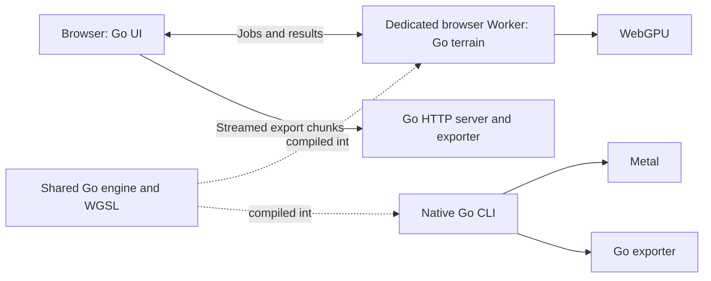

# Go / wgpu port spike

Worktree: `/Users/daniel/src/terraform-wt-go-wgpu`  
Branch: `prototype/go-wgpu`  
Original comparison baseline: `92df846a9fa076021b9f740d04883ee906259b13`  
Concurrent main merged: `dfee4b49cba5473003da7ed3448ba486b3fedad7` (Landform), via `db956cb`

This branch replaces the Python server and JavaScript editor implementation
with Go. The browser retains the existing HTML/CSS UI, driven by Go WASM. A
separate Go WASM Worker runs the shared wgpu terrain pipeline. The native Go
CLI uses that same pipeline to export without a browser. The branch has not
been merged into main.

## Try it

The current session's test server is at <http://127.0.0.1:8891/sculpt> while
its process is running. To rebuild and start another instance from this worktree:

```sh
cd /Users/daniel/src/terraform-wt-go-wgpu
ASSETS_ROOT=/private/tmp/terraform-wgpu-run/assets PORT=8892 ./run.sh --prepared
```

The prepared assets root uses private installed-content catalogs; no retail
pixels or maps are committed. For a fresh root, omit `--prepared`; the helpers
read the installation at `~/TotalAnnihilation` without writing there.

For a native Metal export after building the helpers:

```sh
go run ./cmd/terraform \
  --assets-root /private/tmp/terraform-wgpu-run/assets --prepared \
  --scene repro/recipes/native-hill.json \
  --out /private/tmp/terraform-native-morning
```

Use a fresh output directory. The command prints the actual adapter/backend
and writes the archive, indexed PNG and height data. A recipe saved from the
browser can replace the included synthetic hill fixture.

## What changed

- `internal/model`: deterministic paths, curves, controls, material data,
  features and graph rules, with Go regression tests.
- `internal/terrain`: one shared wgpu shape → ground → time → surface → light
  pipeline using the existing WGSL and material tables.
- `internal/editor`: Go DOM events, canvas overlays, controls, selection,
  history, persistence, documents and export coordination.
- `internal/editorworker`: separate browser runtime for terrain preparation,
  GPU rendering/weathering, feature fills and PNG encoding. Latest requests
  replace queued stale work; bounded tasks yield and can be canceled. Buffers
  transfer back to the UI; export waits for each chunk upload before producing
  another.
- `internal/server` and `cmd/terraform`: Go HTTP/configuration/documents/export
  service and native renderer. The server binds to localhost.
- `web/`: minimal runtime bootstraps. Go's generated WASM support script and
  built WASM files are ignored, rebuilt by `run.sh`, and served compressed. Final stripped UI and worker binaries are
  7,130,726 and 14,551,979 bytes; gzip sizes are 1,896,719 and 3,792,630 bytes.



The two browser runtimes have separate event loops. Goroutines within either
WASM runtime are cooperative work, not a substitute for a background browser
thread. DOM/input stays in the UI runtime; expensive terrain work stays in the
Worker. The native entry point opens no browser.

Ordinary rendering keeps authored fields and weather on the GPU. Height-only
queries omit color/relief targets and do not read all 31 authored planes. GPU
page caches and UI tiles have byte budgets. Large maps preserve main's actual
512-cell weather cores and 128-cell apron. Small maps preserve the global
weather solver. No CPU terrain renderer or alternate old implementation is
retained.

The old runtime Python, application JavaScript and obsolete injected-browser
harnesses were removed. Node remains for browser automation. Python remains
for active offline retail/image analysis, such as comparison sheets.

Main advanced during the run with the Landform integration. Its new shader,
paired front/back section curves, along-path height curve, elevation/combine
modes, spurs, variation controls and terrace breakup are included in the Go port.
The whole-section editor and map section marker follow that integration.

## Dependency decisions

[`gogpu/wgpu`](https://github.com/gogpu/wgpu) is pinned to v0.34.7,
`a7b9b6e85d5d3765b443f2870249d37c31066fe4`. Its production source is vendored with
browser error scopes and uncaptured-error forwarding implemented; the upstream
methods were stubs. [PATCHES.md](../third_party/wgpu/PATCHES.md) records the
changes and native texture-tracker workaround. Native macOS explicitly selects
Metal and fails if unavailable.

[`gogpu/ui`](https://github.com/gogpu/ui) was evaluated but not adopted. Its
current native drawing dependencies (evaluated at
`4d78f0d03a87c5c48bb66d3dc34f625de43067d0`) do not compile for `GOOS=js GOARCH=wasm`.
Keeping the existing HTML/CSS layout under Go preserves the primary browser UI.
A standalone native window UI is not included; native Go rendering/export is.

## Measured verification

All numbers below are measured on this Apple M3 Pro machine unless explicitly
labeled otherwise. These are spike measurements, not claims about other GPUs.

| Check | Result |
| --- | --- |
| Original browser vs Go browser, 27 retail comparison scenes | 0 changed RGBA pixels across all 27 1024×1024 renders (28,311,552 pixels). `compare.py --worlds none` passes. |
| Repeat render | 0 mismatch pixels in every final scene; no browser console errors. |
| Authored field parity, same Chrome | All 27 scenes × 31 planes at 513×513 match the original exactly, including masks. |
| New Landform scenes | Three scenes match current main: 0 changed RGBA pixels, all 31 planes at 513×513 exact, regional/repeat mismatch 0. |
| Regional replay | Whole/repeated/four-region authored replay has 0 mismatches across all 27 scenes. |
| Brushes and undo | 144/144 cases pass across nine worlds (16 brushes including Landform); 8×8 Green passes paged draw/undo, and all 16 brushes pass on a 40×40 Green map. |
| Curve editing | 92/92 checks pass across Green and Desert, including legacy and Landform forms, bilateral/along curves, selected edits, undo and GPU parity after autosave/reload. |
| Browser export | All eight exportable worlds pass at 4×4; Green 8×8 exports 17,436,672 art pixels with 0 clamped height cells. Zhon remains intentionally unavailable. |
| Memory controls | At GPU/heap 128 MiB, a 256×256 render changes 0 pixels; cache 17,429,184 bytes ≤32 MiB. A 96 MiB image job is refused against 64 MiB worker space; restoring budgets changes 0 bytes. |
| Large-map zoom | 8×8 zoom/restoration passes; edited 256×256-cell regional replay compares 3,211,264 packed bytes with 0 differences. |
| Native Metal | Hardware suite passes, including nine material worlds, cached weather, regional seams and height-only rendering. |
| Native browser-free export | Adapter reports `Apple M3 Pro (Metal)`; two runs produce identical `.ufo`, indexed PNG and `heights.json` bytes. |
| Native platforms | CLI cross-compiles without CGO for macOS amd64, Linux amd64/arm64 and Windows amd64; runtime tested only on this Mac. |
| Go tests | Full suite and model/budget/queue/server/CLI race checks pass. Native and WASM-specific `go vet` pass. |
| World-name gate | Production Go terrain engine and WGSL pass. |

The final Landform CLI export also reports `Apple M3 Pro (Metal)` and is in
`/private/tmp/terraform-wgpu-run/native-landform-final`. Native Hill repeat evidence is in
`/private/tmp/terraform-wgpu-run/native-final-a` and `native-final-b`.
SHA-256 of the archive is
`9960e78a5a4b1b30e9bdd4cb77ab44ff7245919d9dc695171556c7936a984d49`;
the indexed PNG is
`ff3d0e888325ff15007b23bb3cf15da08ab77936edaed4ead1f25af9d9401fef`.

Scene evidence is under `/private/tmp/terraform-wgpu-run/before` and
`after-budget-shine-final`; `final-pixel-comparison.json` records its exact
counts. `after-budget-shine-final.log` records the render runs. The final native
hardware log is `native-gpu-final.log` in that same directory. These private
artifacts are intentionally outside git.

## Independent review

An independent reviewer examined export lifecycle, native recipe validation,
feature placement, canvas/path gestures, history, autosave and cleanup. Fixes
include canonical geometry validation before GPU allocation; synchronized
helper stderr and shutdown; isolated job directories and crash cleanup; fresh
worker heights for fills; shared path anchors and frozen screen-space selection
drags; undo scoped to document edits; preservation of failed autosaves; and
persistence of view/seed preferences.

The review also added deterministic yielding during large feature sorts and a
one-hour idle reaper for abandoned export jobs. Active uploads/helper exchanges
are protected from expiry. Race tests cover cleanup, refresh and shutdown;
feature ranking retains the prior 1,810-placement output exactly. Cross-review
of the new Landform UI corrected default-curve serialization and the tool icon.
Authored ghost samples include offscreen terrain: 443 points are returned, and
four independent GPU interpolation checks differ by 0.0.

Browser export cancellation passed during start, chunk upload and finish. Each
returned cancellation, restored the editor, left zero temporary jobs and had
zero console errors. The observed checks took 1.03–1.26 seconds including a
one-second cleanup observation. Dedicated tests cover the paths, feature draw
ordering, curve reload and export cancellation.

The long audit exposed a cancellation deadlock: a passive Landform ghost job
could replace an awaited capture without replying. Foreground RPCs now block
passive sampling, and every canceled/dropped awaited job gets a terminal reply.
RPC images are never marked as viewport tiles. A browser regression holds a
capture for 800ms: it completes, no ghost request interrupts it, both explicit
cancellations are acknowledged, and the console has 0 errors.

## Controls and performance

The completed nine-world audit has 4,638 rows and 0 unexplained findings,
0 hidden-but-moving controls, 0 restoration leaks and 0 console errors. It
includes 1,145 enabled-world checks, 691 gated-world checks, 2,727 stroke checks,
13 surface-slider checks, 53 checks with distinguishing colors, and nine final
restoration checks. Of the gated rows, 189 could not be measured because no ordinary knob combination clears their gate;
these are not claimed as measured zero-impact results.

Green and Red's original full reports predate the fixes below. The qualified
aggregate replaces only the affected rows with targeted retests of the final
code and removes a hidden legacy slider that main also excludes. The other
seven worlds have complete passing runs. Raw reports and exact replacement
provenance remain in
`/private/tmp/terraform-wgpu-run/control-final/resolved-summary.json` and
`resolved-world-controls.json`. Full-frame 1024×1024 control diagnostics use
1024 MiB GPU and 2048 MiB heap budgets; ordinary editing and export were tested
at their default 512 MiB GPU budget. The stricter renderer guards correctly
refused diagnostic workloads exceeding that default.

The shape-control sweep passes; all nine new Landform controls move 32.4–82.3%
of 16-pixel blocks on the authored Green fixture, above the 5% threshold. This
impact fixture is separate from the three retail windows.
The sweep found and fixed a hidden slope-shine activation bug; the targeted Red
retest has 0 unexplained controls. It also caught and fixed Undulation failing
to create the initial ground stroke; the final focused test changes 233,828 pixels
and restores the scene with 0 leaked pixels. New ground also uses the displayed
scale/coverage instead of main's fixed 160/.5 creation values. Undo/redo
synchronizes only those three ground controls with the restored stroke graph;
the custom 8/296/.25 fixture restores identical authored GPU bytes.

Alternating current-main/Go runs found and then fixed a real responsiveness
regression: the first Go worker canceled every tile during continuous movement
(0 accepted changed tiles, 70/70 moves censored, frame p95 117–133ms). The final
scheduler lets one bounded tile finish while replacing one pending snapshot,
prioritizes the pointer, and uses the same pipeline's interactive quality with
Time deferred until release. Canonical rendering and export keep full quality.

The final quiet comparison alternated current main and Go once per tool, after
all fixes, at a 1020×989 viewport on the 4×4 Green fixture. Values below are
Hill / Landform, in milliseconds unless stated otherwise:

| Metric | Current main | Go worker |
| --- | --- | --- |
| Initial scene complete after editor boot | 1,057.4 / 1,050.1 | 924.5 / 945.8 |
| First changed picture on scene load | 16.1 / 15.8 | 52.9 / 52.7 |
| Drag animation-frame p95 | 16.8 / 16.8 | 16.8 / 16.7 |
| Moves receiving changed terrain | 70/70 for each tool | 70/70 for each tool |
| Move-to-changed-picture p50 | 16.0 / 15.6 | 58.0 / 57.3 |
| Move-to-changed-picture p95 | 18.7 / 17.6 | 70.6 / 75.1 |
| Release to full picture | 555.1 / 505.6 | 784.7 / 786.0 |
| Scroll completion after stopping | 133.9 / 134.5 | 122.7 / 114.0 |

All four runs had 0 censored moves, 0 missing final visible tiles and 0 console
errors. Go produced 160 / 167 fresh drag bakes versus main's 211 / 211. The
input thread remains responsive, but terrain feedback and release still trail
the original. These results do not justify claiming equal speed. Reducing GPU
readback round trips is a remaining performance opportunity.

Move-to-picture measures the first newly baked chunk paint whose source
revision includes the move; it is not physical input-to-display latency.
Animation-frame intervals describe input/display scheduling, not terrain GPU
completion. Scene timing starts after editor boot and excludes network cold
start. Recorded boot-to-idle was 1,075 / 974ms on main and 1,088 / 1,153ms in Go.
Wider-view freshness also trails the cursor preview. The repeatedly-dirty-chunk
p95 diagnostic is 332.9 / 331.8ms for main and 1,788.9 / 1,742.2ms for Go, but
qualifying sets differ (20 chunks and 64 samples versus six chunks and 20 / 19
samples), so these are not a like-for-like speed ratio. Cached canvas redraw
counts are not presented as fresh terrain frames.

Go's retained RGBA/height tile data at the end is 244,547,184 / 249,506,776 bytes,
within its 268,435,456-byte tile budget. Main's bitmap cache is 19,435,520 bytes;
the representations differ, but the larger Go cache is a memory cost. Budgets
track owned page/field/image data, not total browser, runtime or driver memory.
No whole-process GPU/heap peak is claimed.

This is one final alternating pair per tool, with earlier development runs
showing the same direction, not a statistical survey. Final raw results and
`summary.json` are in `/private/tmp/terraform-go-perf-final`.

An erosion dispatch optimization preserves shader results while replacing 1,200
pass/group creations with one compute pass and four reusable bind groups. On a
200-age, 33×33 fixture, alternating runs measured unbatched 257.1/254.6/258.4ms
versus batched 30.8/25.5/25.1ms (10.1× median improvement). This microbenchmark
is separate from complete editor interaction performance.

A same-recipe browser/native comparison has exactly matching 1,360 height
cells. Indexed art differs in 5/348,160 pixels for Hill and 41/348,160 pixels
for Landform. A separate unsnapped Hill diagnostic differs in 78 pixels / 82
channels, at most 1/255 per channel; this is consistent with compiler rounding.
Browser TNT bytes repeat exactly; native archive, PNG and heights repeat
exactly. Cross-backend bit identity is not claimed. Artifacts are under
`/private/tmp/terraform-parity-review`.

By eye, the whole-section/along editors, ghost curves, map marker and restored
Landform icon match the current interface. A manual draw in the final Go editor
produced the expected raised, textured landform. The screenshot is
`/private/tmp/terraform-landform-review.png`.

Runtime verification is limited to Chrome WebGPU and native Metal on this Mac.
Cross-compilation is not runtime validation. Native and browser floating-point
intermediates can differ slightly across GPU backends; determinism is verified
within the same machine/backend, not promised across all hardware. A full
40×40 map export and every other browser/OS combination have not been measured.
